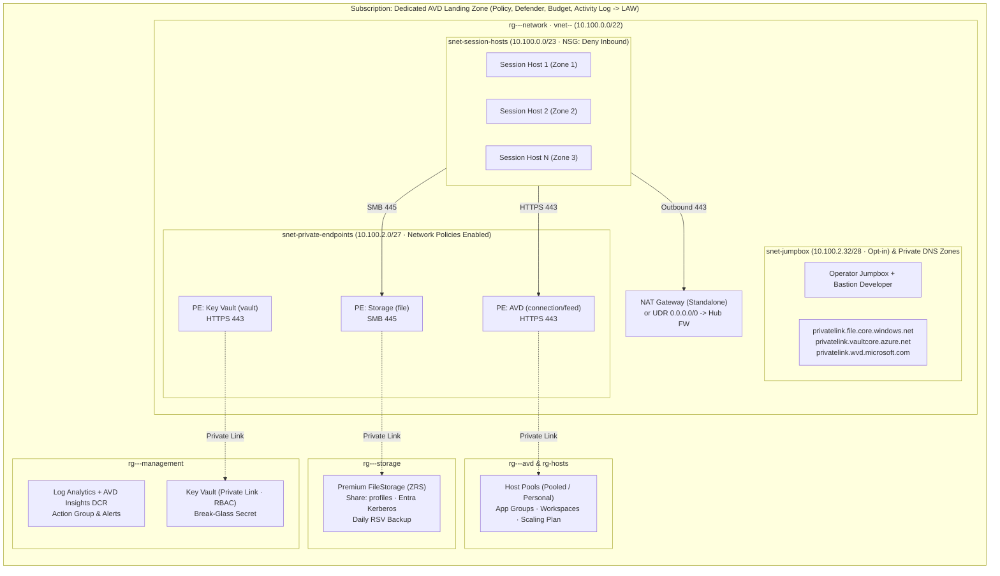
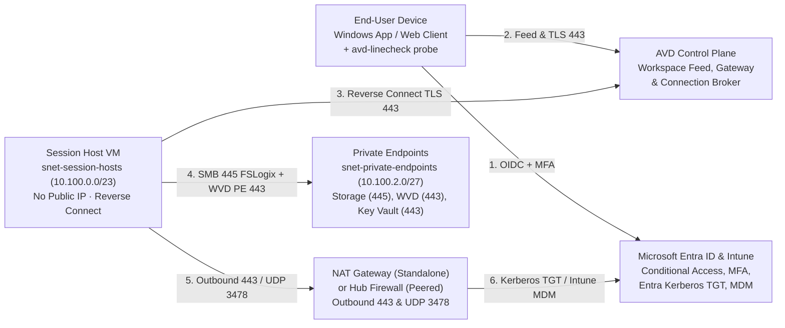
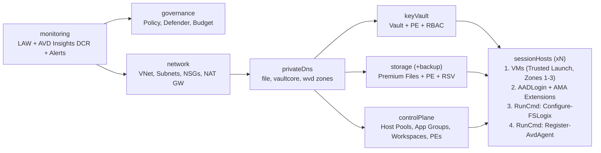

# Architecture

## Layout

```
Subscription (dedicated AVD landing zone)
│  Policy: allowed locations, tag inheritance · Defender for Cloud · Budget · Activity log → LAW
│
├── rg-<prefix>-<env>-network
│     vnet-<prefix>-<env>            10.100.0.0/22
│       snet-session-hosts           10.100.0.0/23   NSG · NAT GW (standalone) or UDR→hub FW · no default outbound
│       snet-private-endpoints       10.100.2.0/27   NSG enforced on PEs (445 from hosts, 443 from VNet)
│       snet-jumpbox (opt-in)        10.100.2.32/28  NSG · same egress as the hosts · no public IP
│     Bastion Developer bas-<prefix>-<env> (opt-in, no charge, decision 0019)
│     private endpoints: file, vault, host pool (connection)
│     privatelink zones: file, vaultcore, wvd       (standalone; hub mode can use central zones)
│
├── rg-<prefix>-<env>-management
│     Log Analytics · AVD Insights DCR (microsoft-avdi-*) · action group · alerts
│     Key Vault (private, RBAC): break-glass local admin
│
├── rg-<prefix>-<env>-storage
│     Premium FileStorage (ZRS): share "profiles" · Entra Kerberos · shared key off
│     Recovery Services vault: daily share backup
│
├── rg-<prefix>-<env>-avd
│     Host pool (pooled, Private Link) · Desktop app group · Workspace · Scaling plan
│
├── rg-<prefix>-<env>-hosts
│     Session hosts ×N (zones 1/2/3, Trusted Launch, encryption at host)
│       extensions: AADLoginForWindows (+Intune), AzureMonitorWindowsAgent, GuestConfiguration
│       run commands: Configure-FSLogix → Register-AvdAgent
│
└── rg-<prefix>-<env>-jumpbox (opt-in, deploy.sh --jumpbox)
      Operator jumpbox: Ubuntu (B2als_v2) or Windows Server 2025 (B2as_v2), Trusted Launch, daily stop, Cloud Shell's tools
```



## Traffic flows

| Flow | Path |
|---|---|
| User → desktop | Windows App → AVD gateway (public, reverse connect; RDP Shortpath where available). Session hosts accept no inbound connections |
| Session host → AVD service (host pool) | Private endpoint `connection` sub-resource via `privatelink.wvd.microsoft.com` |
| Session host → FSLogix share | SMB 445 → storage private endpoint; Kerberos ticket from Entra ID |
| Session host → Entra ID, Intune, Windows Update, M365, AVD agent downloads | Egress through the NAT Gateway (standalone) or the hub firewall (hub-peered) |
| Session host → Log Analytics | Azure Monitor Agent over egress |
| Operator → Key Vault | Private endpoint, reachable from the VNet or peered networks only |



In **hub-peered** mode your firewall must allow the [AVD required FQDNs](https://learn.microsoft.com/azure/virtual-desktop/required-fqdn-endpoint) plus Entra ID, Intune and Windows Update endpoints.

## Identity and access (RBAC)

| Principal | Role | Scope |
|---|---|---|
| AVD Users group | Desktop Virtualization User | Desktop application group |
| AVD Users group | Virtual Machine User Login | `hosts` RG |
| AVD Users group | Storage File Data SMB Share Contributor | Storage account |
| AVD Admins group | Virtual Machine Administrator Login | `hosts` RG |
| AVD Admins group | Storage File Data SMB Share Elevated Contributor | Storage account |
| AVD Admins group | Key Vault Secrets User | Key Vault |
| Azure Virtual Desktop SP | Desktop Virtualization Power On Off Contributor | `avd` and `hosts` RGs |
| Tag-inheritance policy identities | Tag Contributor | Subscription |

## Agent updates

The host pool takes AVD agent updates in one window, Saturday 02:00 in each host's local time (`controlPlane.bicep`). [Scheduled Agent Updates](https://learn.microsoft.com/azure/virtual-desktop/scheduled-agent-updates) (git_commit_id 4dcb5ff, 2025-06-25) asks that every host be on during the window: an update fails on a host that is off, the broker tries again in the next windows and installs by force after the fourth, and a critical update is always forced. The scaling plan's weekend minimum is 0% and the optional auto shutdown deallocates hosts at night, so in this landing zone most hosts are off in that window and take updates when the broker forces them. That is fine for the one-host demo. For a real pool, choose one of these before relying on the window: start the hosts for the window and exclude them from scaling while it runs, or add the optional second window at a time your hosts are on. Either one changes the scaling and power design and needs a mock path and a scenario assertion.

## Deployment order

`monitoring` → `network` → `privateDns` → `keyVault`, `storage` (→ `backup`), `controlPlane` → `sessionHosts` (VMs → FSLogix run command → agent run command). `governance` runs as soon as the workspace exists.
Dependencies come from outputs, so ARM parallelizes everything else.



## Why AVM

Resources come from pinned [Azure Verified Modules](https://aka.ms/avm). Native resources are used only where no module exists or the module adds nothing: Run Commands, backup protection, role assignments at resource group scope, policy, Defender pricings, budget and alerts.
